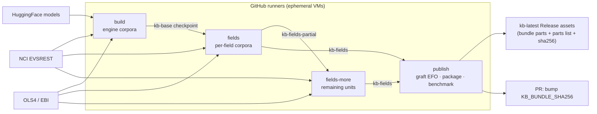

# KB lifecycle: build → publish → consume → refresh

The engine's knowledge base (FAISS + SQLite indexes over NCIt / UBERON / MONDO /
EFO) and the embedding models are large and built **out-of-band**, then shipped as
one offline bundle (`kb_offline_bundle.tar.gz`). Running instances **seed** that
bundle — they never build it.

The exact maintainer order is `build_kb` → `build_kb --fields` →
`warm_schema_cache` → `package_kb`. Packaging is fail-closed: it will not
publish a bundle missing a required corpus, FAISS index/ID sidecar, engine
database, embedding model, or schema cache. Import validates the archive before
extraction and verifies the installed assets afterward.

## What the KB holds

- **The engine's own corpora**, routed by field name in any target schema:
  NCIt Neoplasm (disease), NCIt Pharmacologic Substance (treatment), UBERON
  (body site), and EFO (phenotype, carried forward).
- **Per-field corpora** of the target schemas' data dictionaries
  (`app/engine_adapter/_field_corpora.py`), the lab's design: each dictionary
  field's `dynamic.enum` roots (descendants or children) and listed ontology
  terms, one *unit* per root or per ontology's listed terms, shared by every
  field and schema that names it. A field is mapped against each of its units
  and the candidates are merged by score (the engine's `merge_match_results`).
  Units are optional at runtime: until the KB holds a field's units, the field
  keeps its engine corpus or the value dictionary. Ontologies the engine cannot
  fetch at the vendored commit (HANCESTRO, SNOMED CT) and obsolete roots are
  left out.

## Refresh pipeline (`.github/workflows/kb-refresh.yml`)

Runs on **ephemeral GitHub runners** (manual `workflow_dispatch` or a quarterly
cron). Nothing runs on your laptop or the prod server — the runners fetch,
build, compress, upload, then are destroyed. The jobs, each under GitHub's
6-hour job limit, hand a packaged checkpoint on as a workflow artifact; when the
per-field corpora do not all fit in `fields`, `fields-more` continues from the
units it built:



- **Downloads / requests** happen on the runners: NCIt via EVSREST, UBERON and
  MONDO via OLS4, models from HuggingFace (+ optional `UMLS_API_KEY` secret for
  synonym enrichment — base corpora fetch key-free). A unit's fetch is retried,
  since NCI EVSREST and OLS4 fail transiently.
- **Tar / compress** via `package_kb` → `kb/kb_offline_bundle.tar.gz`.
- **Upload** to the `kb-latest` GitHub Release in parts under the 2 GiB asset
  limit (`kb_offline_bundle.tar.gz.part00`, …, listed in order by
  `kb_offline_bundle.tar.gz.parts`) with `kb_offline_bundle.sha256`, the whole
  bundle's checksum (`gh release upload --clobber`; the previous publication's
  leftover assets are deleted). A PR then bumps `KB_BUNDLE_SHA256` so the
  download integrity check stays valid. When GitHub won't let Actions open the
  PR, an issue links to it instead (see
  [Automation pull requests](release-process.md#automation-pull-requests)).
- **Report** in the GitHub Actions summary: per-corpus rows, added/removed IDs,
  relabeled IDs, and before/after mapping-quality metrics. The same evidence,
  including affected ID lists, is retained for 90 days as JSON/CSV artifacts.

The cold ontology build is inherently compute- and network-heavy. Historical
clean runs of the engine corpora took about 3 hours 20 minutes; the per-field
corpora (NCIt *Disease or Disorder*, MONDO, NCIt *Drug, Food, Chemical or
Biomedical Material*, …) take hours more in their own job. That cost belongs to
the quarterly maintainer workflow, never to deployment or a user's first task.
The workflow exposes `reuse_run_id` so a failed run resumes from that run's
latest checkpoint: its field-corpora checkpoint (only `publish` reruns), its
partial one (`fields` continues with the units not built yet, then `publish`),
else its engine-corpora one (`fields` and `publish` rerun).

Two more inputs serve a manual run. `fields_only` rebuilds only the per-field
corpora, on the published bundle's engine corpora, skipping the 3-hour
`build` (for a change to a schema's data dictionary). `dry_run` builds and
benchmarks but publishes nothing: the candidate bundle is kept as the
`kb-candidate-<run>` artifact for 7 days.

## Consume (every instance, local or prod)

```
docker compose --profile kb run --rm kb-import   # download from KB_BUNDLE_URL + verify sha256 + seed volumes
docker compose up --build                        # api/worker load the KB + models offline (HF_HUB_OFFLINE=1)
```

The import command runs `scripts.kb_probe` for disease/NCIt, bodysite/UBERON,
and treatment/NCIt. `/readyz` reports `ontology_kb=ok` only after the same
contract passes, and ontology submissions receive HTTP 503 before upload if it
does not. The worker repeats the check for jobs inserted outside the API.

The bundle is a **point-in-time snapshot**; studies are stamped with the
schema/ontology version they were harmonized against (`SchemaVersion` /
`OntologySnapshot`) so results stay reproducible even after a later refresh.
Learned decisions live in PostgreSQL and are not replaced by a bundle refresh.
The impact report identifies removed or relabeled ontology IDs that may require
an administrator to review corresponding learned targets.
